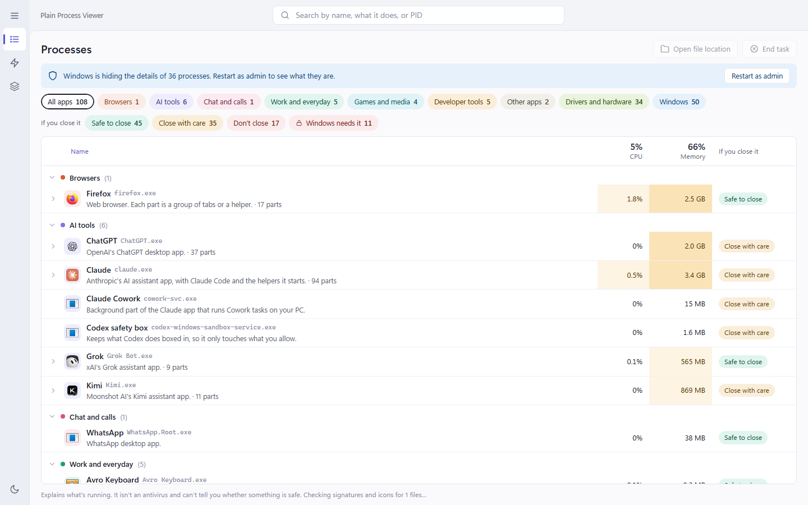
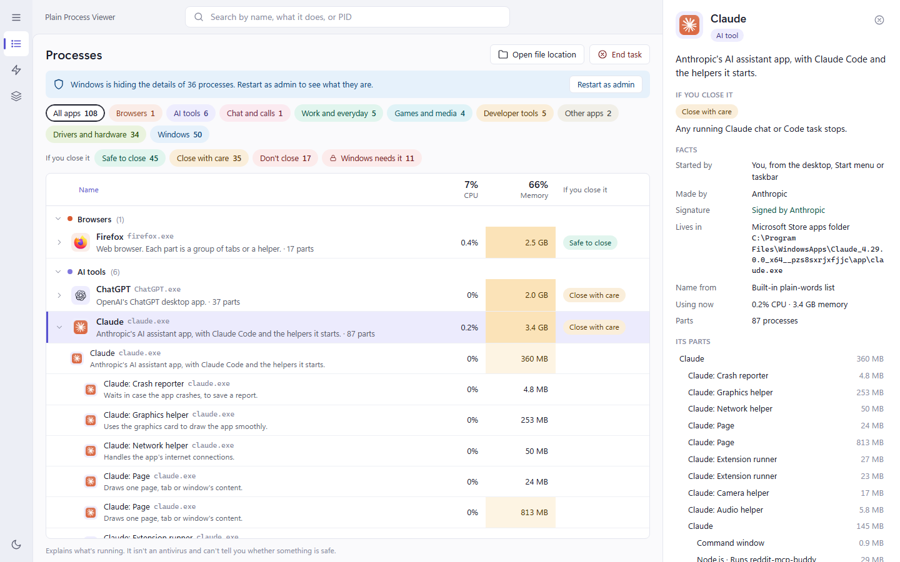
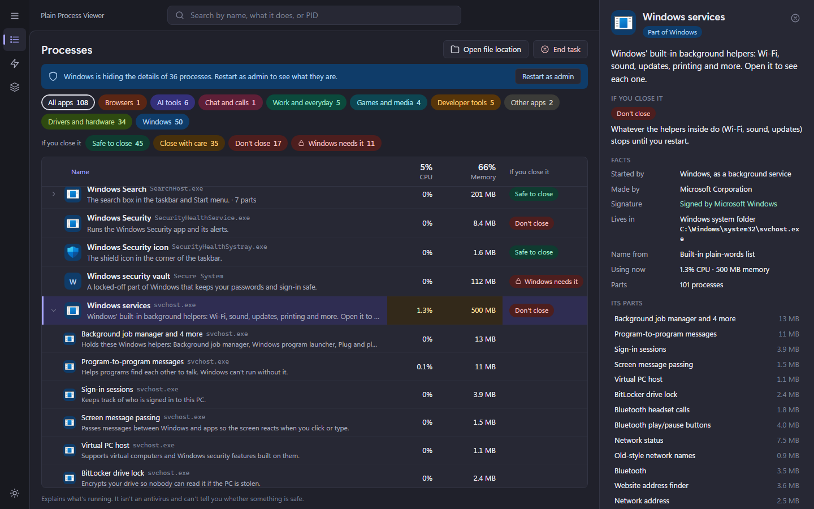
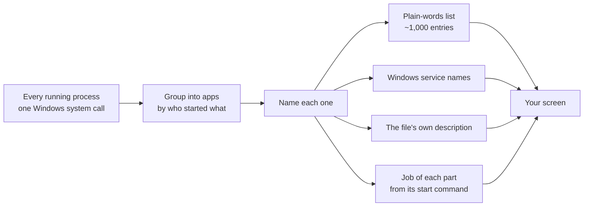

# Plain Process Viewer

**Know what you're closing before you close it.** Plain Process Viewer sorts everything running on Windows into apps you recognise, explains each part in everyday words, and tells you what happens if you end it.



---

## Why I built this

I have a cybersecurity background, and I still couldn't read Task Manager.

Open it on a normal PC and you get a wall of names: 98 lines that all say `svchost.exe`, 30 copies of `firefox.exe`, `esrv.exe` with no description at all, `jhi_service.exe` described only as "Intel(R) Dynamic Application Loader Host Interface". When one of them is eating memory, or just looks odd, closing it is guesswork. You end it and hope nothing breaks.

Process Explorer and System Informer show far more detail, but they're made for analysts: handles, hashes and virus scores rather than sentences.

I wanted the opposite: open it, read it, understand it. **What is this, why is it running, and is it safe to close?** In words anyone can follow.

That matters more now that so many of us run each other's half-finished tools, AI agents and side projects. A PC fills up with `node.exe`, `python.exe` and `uv.exe` helpers that nobody can name. This app tells you that the `node.exe` under Claude is "Runs reddit-mcp-buddy" and the one under VS Code is "TypeScript code helper".

## What it does

**Names everything, in everyday words.** Every program and helper gets the name a person would use and one sentence about what it does for you, with its real file name in small grey text beside it. `dwm.exe` becomes *Screen drawer: Draws your windows, shadows, see-through effects and animations on screen.* `BITS` becomes *Background downloads: Downloads updates slowly using spare bandwidth, so your internet stays fast.*

**Groups the clutter into apps.** About 450 processes become roughly 110 rows. Each app opens to show its parts, and each part says what it's for: "Firefox: Tabs", "Claude: Network helper", "Python · Runs reddit_rss.py", "Gradle build helper".

**Tells you what happens if you close it.** Every app is marked *Safe to close*, *Close with care*, *Don't close*, or *Windows needs it*, with a sentence on what you'd lose. Ending the parts Windows can't live without is blocked.

**Filters by kind and by risk of closing.** Chips along the top filter by Browsers, AI tools, Chat, Work, Games and media, Developer tools, Drivers and hardware, Windows. A second row filters by what happens if you close it, so "show me everything that's safe to close" is one click. **Not on our list** shows everything the built-in list doesn't know yet, named from the file itself.

**Shows who started what.** Every app shows what launched it ("You, from the Start menu", "Windows, as a background service", or another app), who made it, whether it's signed, and where it lives. A program you open from your browser's downloads gets its own row, marked as opened from the browser, instead of hiding among the browser's parts.

**Points out unusual things, without crying wolf.** Notepad or Calculator starting other programs, Office starting PowerShell, a Windows name running outside the Windows folder, a name one letter off a Windows part, a program running from Downloads or Temp. These are shown as notes to check, never as verdicts.

**Ask an AI when you're still not sure.** One button builds a ready-to-paste question with everything useful (name, folder, maker, signature, what started it, its start command, its internet connections) and copies it. Paste it into ChatGPT, Claude or any chat. Your user name and anything that looks like a password or key are hidden first.

**Startup apps and Services, explained the same way.** See what starts when you sign in, and what each of Windows' background services actually does.





## What it isn't

**It doesn't judge safety.** It never calls a program safe or harmful: a familiar name proves nothing, because malware can borrow real names. Plain Process Viewer explains what's running; Microsoft Defender (or whichever virus protection you use) stays your protection.

## How it works



- **One fast read of everything.** It asks Windows for every process in a single call, the same way advanced task managers do. That gives parents, CPU time and the exact "Memory" figure Task Manager shows, refreshed every two seconds.
- **Grouping.** Each process is followed up through its parents until it reaches Windows itself (Explorer, the service manager), so helpers sit under the app that started them.
- **Naming, in this order:** the built-in plain-words list, Windows' service list, the file's own description, its product name, its app package name, then the file name. The details panel always says which one was used.
- **Parts by job.** Browsers and apps built on Chromium or Electron tag each helper with its role in the start command (`--type=renderer`, `--type=gpu-process`). Firefox does the same. For Python, Node.js, Java and .NET it reads which script, package or main class is running.
- **Signatures and icons** are checked once per file in the background and cached.

**Your process list stays on your PC.** The app runs a small local server on `127.0.0.1` that only its own window can talk to (a fresh secret key each launch), and it doesn't send what's running anywhere. The only time anything is shared is when you copy an Ask-an-AI question and paste it yourself.

### The plain-words list

About 780 programs and 195 Windows services, written for this app in everyday language:

- **Windows itself:** core parts, background services, built-in apps, admin tools and command-line helpers.
- **Developer tools:** editors and IDEs (VS Code, Cursor, JetBrains, Visual Studio, Zed, Neovim), languages and build tools (Python, Node.js, Java, .NET, Go, Rust, Gradle, MSBuild), Git tools, terminals, Docker, WSL, Hyper-V, VirtualBox, VMware, databases (PostgreSQL, MySQL, MongoDB, Redis, SQL Server), API and network tools, cloud command lines, and AI coding tools.
- **Everyday software:** browsers, chat apps, office and notes apps, password managers, VPNs, cloud storage, creative apps (Adobe, DaVinci Resolve, Blender), game launchers and anti-cheats, antivirus suites, and hardware helpers (NVIDIA, Intel, AMD, ASUS, Logitech, Razer, Corsair).

Anything not on the list still gets a name from the file itself, and the Ask-an-AI button covers the rest.

## Download

Download **PlainProcessViewer.exe** from the [Releases page](../../releases/latest) and double-click it. There's nothing to install and you don't need Python. It needs 64-bit Windows 10 or 11 and opens in about two seconds. On small or zoomed-in screens (tablets, foldables) it opens full-screen.

**Windows will probably warn you the first time.** The .exe is unsigned for now (a signing certificate is a yearly cost), which is why SmartScreen may say *Windows protected your PC*; choose **More info**, then **Run anyway**. Python-packaged apps also get mistaken for threats by some virus scanners now and then. Microsoft Defender found nothing in this build, and if you'd rather not trust a download, you can run it from the source below.

Each time it starts, it unpacks itself into a temporary folder and removes that folder when you close it. That's why Plain Process Viewer lists itself as two parts, *Starter* and *App*.

## Run from source

Needs 64-bit Windows 10 or 11 and Python 3.11 or newer. [uv](https://docs.astral.sh/uv/) makes setup two lines:

```
uv venv .venv
uv pip install --python .venv\Scripts\python.exe flask psutil pywin32 pywebview
```

Then double-click **Plain Process Viewer.cmd**. It opens in its own window (using Edge WebView2, built into Windows 11). To open it in your browser instead:

```
.venv\Scripts\python.exe main.py --browser
```

Windows hides some details unless the app runs as admin. When that happens the app shows how many are hidden and offers **Restart as admin**.

If it can't start, it says why in a message box and saves the details to `%LOCALAPPDATA%\PlainProcessViewer\error.log`.

### Build the .exe yourself

```
uv pip install --python .venv\Scripts\python.exe pyinstaller
.\build.ps1
```

This makes `dist\PlainProcessViewer.exe` (about 14 MB), with Python, the plain-words list and the interface inside.

## Project layout

| File | Job |
| --- | --- |
| `app/sysinfo.py` | Reads every process in one call (`NtQuerySystemInformation`), plus file details and services. |
| `app/knowledge.py` | Groups processes into apps, names each part, picks the kind, close label and unusual notes. |
| `app/data/known.json`, `app/data/processes-*.json` | The plain-words list of programs. |
| `app/data/services.json` | Plain names and explanations for Windows services. |
| `app/enrich.py`, `enrich.ps1` | Signatures and icons, checked once per file and cached in `%LOCALAPPDATA%\PlainProcessViewer`. |
| `app/startup.py` | Startup apps from the Run keys and Startup folders, with their on/off state. |
| `app/server.py` | The local server: process data, End task (with checks), Ask an AI, Startup and Services. |
| `app/static/` | The interface. |
| `main.py` | Opens the app window. |
| `build.ps1`, `packaging/version.txt` | Build the single .exe and set the file details Windows shows for it. |
| `packaging/notices.py` | Collects the licences of everything packed into the .exe into `THIRD-PARTY-NOTICES.txt`. |

## Adding to the plain-words list

Each entry is one line of JSON, keyed by the lowercase file name:

```json
"esrv.exe": {"title": "Intel usage data", "what": "Records how your PC is used (power, performance) for Intel's improvement program.", "kind": "hardware", "close": "safe", "note": "Nothing you use stops."}
```

- **title:** what a person would call it. Not the company's internal product name.
- **what:** one sentence about what it does *for you*. Say it the way you'd explain it to a friend. Avoid "service", "host", "framework", "telemetry", "provider"; say "background helper", "usage data", and so on.
- **kind:** `browser`, `ai`, `chat`, `work`, `media`, `dev`, `hardware`, `windows` or `other`.
- **close:** `safe`, `care`, `keep` or `critical`, and **note** says what you'd lose.
- A key ending in `*` matches by prefix, e.g. `"powertoys.*"`.

## Planned

- A **Suggest a better description** box: your wording replaces the built-in one, saved on your PC, and can be sent back to the list.
- A **What's new since last time** badge for programs you haven't seen running before.
- Code signing, so Windows stops warning on first run.
- Optional EchoTrail lookups (bring your own free key) for programs no list knows about.
- Turning startup apps on and off from inside the app.

## Licence

Released under the [MIT licence](LICENSE): you're free to use, change and share it, including in your own projects. The .exe also packs Python and other open-source parts (Flask, psutil, pywin32, pywebview, Microsoft's WebView2 files and more); their licences are in [THIRD-PARTY-NOTICES.txt](THIRD-PARTY-NOTICES.txt).
